<div align="center">

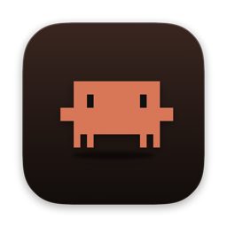

# Claude Pet

**Die Dynamic Notch für deinen Mac.**<br>
Claude Code, Codex, Musik, Termine und WhatsApp, direkt in der Kamera-Notch.

[](#installieren)
[](Package.swift)
[](Sources/ClaudePet)
[](LICENSE)
[](#woher-die-daten-kommen)

<a href="https://github.com/Maiki09k/claude-pet/raw/main/docs/claude-pet-demo.mp4">
  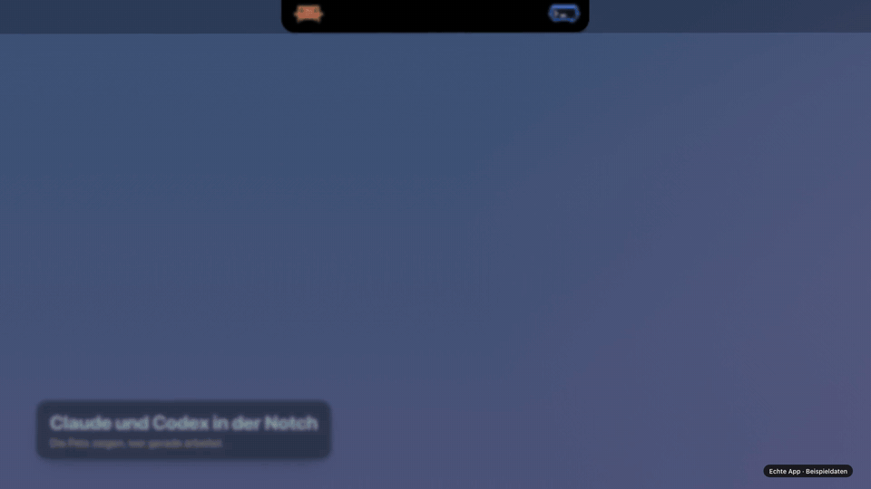
</a>

<sub><a href="https://github.com/Maiki09k/claude-pet/raw/main/docs/claude-pet-demo.mp4">Ganzen Demo-Film herunterladen</a> (MP4, 30 s, mit Ton) · alle Bilder sind die echte App mit Beispieldaten</sub>

</div>

## Was die Notch kann

Zu sieht man nur die Kamera. Sobald etwas wichtig wird, wachsen links und rechts kleine „Ohren“, und mit der Maus darüber klappt die Notch auf. Dann erscheinen nur die Rubriken, die gerade zählen.

<table>
<tr>
<td width="50%" valign="top">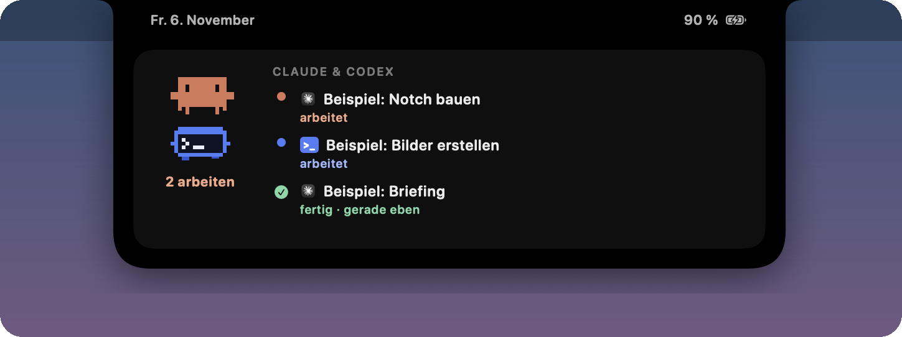<br><b>Claude und Codex live.</b> Clawd und das Codex-Pet zeigen, wer arbeitet, wartet oder fertig ist, mit den Namen deiner Sessions.</td>
<td width="50%" valign="top">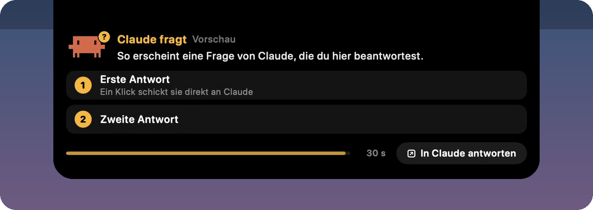<br><b>Claude fragt, du klickst.</b> Fragen aus Claude Code beantwortest du direkt in der Notch. Ein Klick schickt die Antwort zurück.</td>
</tr>
<tr>
<td valign="top">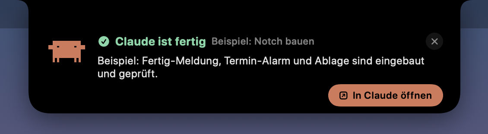<br><b>Fertig-Meldung.</b> Wird eine Session fertig, steht die erste Zeile der Antwort kurz oben, mit Sprung in die App.</td>
<td valign="top">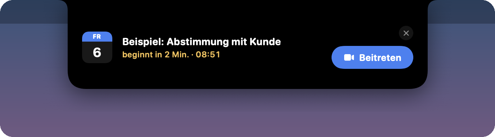<br><b>Termin-Alarm.</b> Zwei Minuten vorher, mit großem „Beitreten“ für Meet, Zoom, Teams und Webex.</td>
</tr>
<tr>
<td valign="top">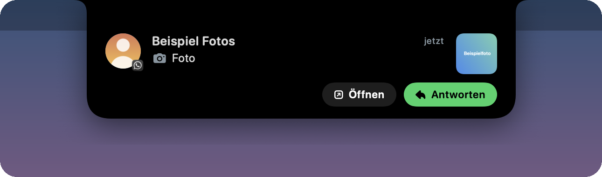<br><b>WhatsApp (optional).</b> Neue Nachrichten fallen als Banner herunter. Ein Klick öffnet den Chat.</td>
<td valign="top">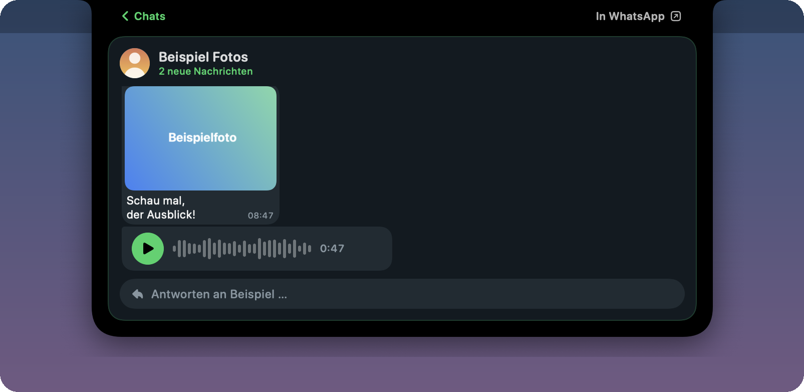<br><b>Der ganze Chat.</b> Fotos, Dokumente, Sprachnachrichten zum Anhören und Antworten, ohne WhatsApp zu öffnen.</td>
</tr>
<tr>
<td valign="top">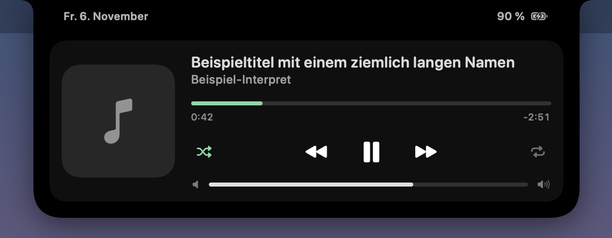<br><b>Musik.</b> Spotify oder Apple Music mit Cover, Spulen, Zufall und Lautstärke.</td>
<td valign="top"><br><b>Lade-Blitz.</b> Beim Einstecken kurz der Blitz und der Akkustand.</td>
</tr>
</table>

**Alles auf einmal:** Mehrere Rubriken teilen sich die Breite, eine allein füllt die ganze Notch.

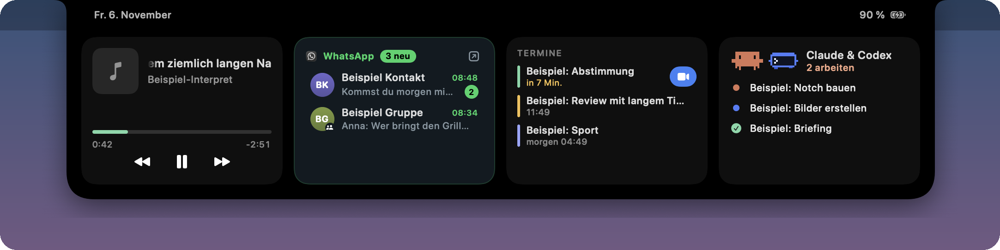

<table>
<tr>
<td width="42%" valign="top">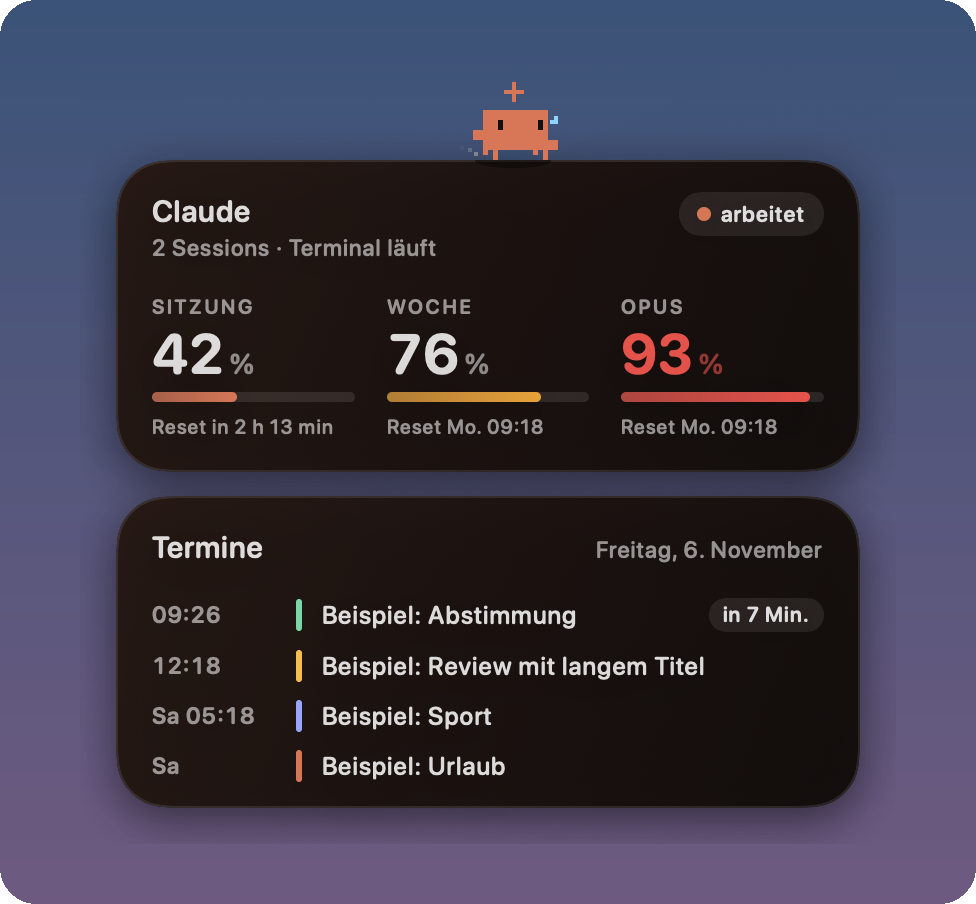<br><b>Clawd auf dem Schreibtisch.</b> Eine Karte mit Sitzungs- und Wochenlimit, darüber krabbelt Clawd, darunter die nächsten Termine.</td>
<td width="58%" valign="top">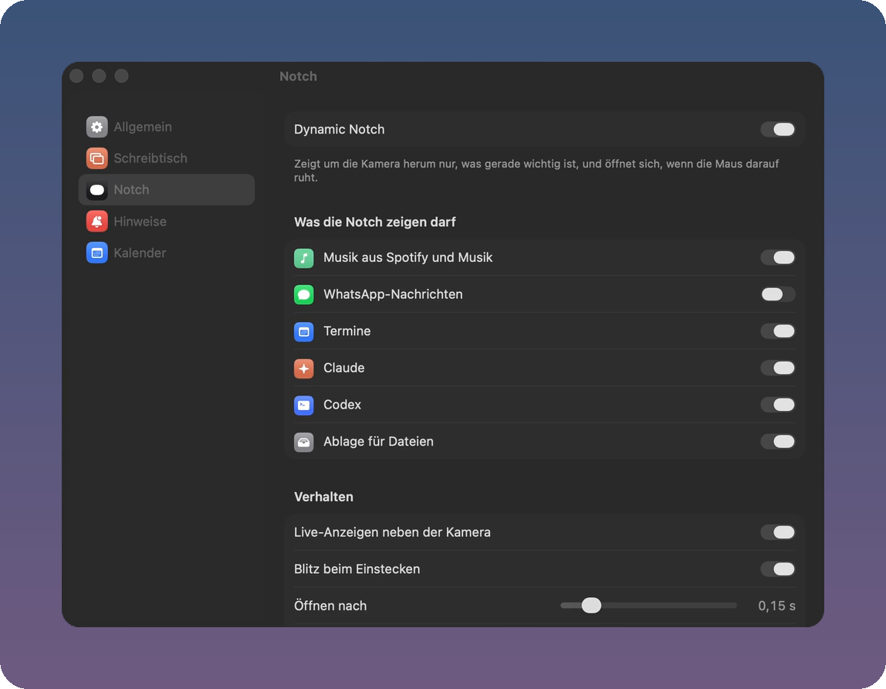<br><b>Alles einstellbar.</b> Jede Rubrik einzeln an und aus, Glas-Stil, Hinweise und Kalender, in einem Fenster wie die Systemeinstellungen.</td>
</tr>
</table>

## Installieren

Du brauchst ein MacBook mit Notch, macOS 15 oder neuer (das echte Liquid Glass gibt es ab macOS 26) und die Xcode-Kommandozeilenwerkzeuge mit Swift 6.2.

```bash
git clone https://github.com/Maiki09k/claude-pet.git
cd claude-pet
./scripts/install.sh
```

Das Skript baut die App, legt sie unter `~/Applications/ClaudePet.app` ab und startet sie. Beim ersten Start fragt macOS einmal nach dem Kalender und danach, ob Claude Pet Spotify oder Musik steuern darf. Die Einstellungen öffnest du, indem du Claude Pet erneut startest oder mit Rechtsklick auf die Karte.

## Woher die Daten kommen

Alles läuft lokal auf deinem Mac. Es gibt keine Telemetrie und keinen eigenen Server.

| Rubrik | Quelle |
|---|---|
| Claude Code | Transkripte in `~/.claude/projects/*/*.jsonl` (CLI und Desktop-App), nur lesend |
| Codex | Rollouts in `~/.codex/sessions/` und Namen aus `~/.codex/session_index.jsonl`, nur lesend |
| Limits auf der Karte | dieselbe Abfrage wie `/usage`: der Login der Claude-Code-CLI aus dem Schlüsselbund (`Claude Code-credentials`), abgefragt bei `api.anthropic.com/api/oauth/usage`. Die App speichert keine Zugangsdaten. Der Endpunkt ist nicht offiziell dokumentiert und kann sich ändern. |
| Termine | macOS-Kalender (EventKit); Google-Kalender, wenn das Konto unter Systemeinstellungen › Internetaccounts eingebunden ist |
| Musik | Systembenachrichtigungen von Spotify und Musik, Titel und Cover per AppleScript |
| WhatsApp (optional) | die lokale Datenbank einer laufenden [whatsapp-mcp](https://github.com/lharries/whatsapp-mcp)-Bridge |

<details>
<summary><b>WhatsApp einrichten</b></summary>

Claude Pet liest die Datenbank der Bridge standardmäßig unter `~/whatsapp-mcp/whatsapp-bridge/store`. Liegt sie woanders:

```bash
defaults write io.github.maiki09k.claudepet whatsapp.store /pfad/zu/whatsapp-bridge/store
```

Danach die App neu starten. Antworten gehen über die Bridge (`127.0.0.1:8080/api/send`); gesendet wird nur, was du selbst tippst und mit Enter abschickst. Profilbilder (`/api/avatar`) und „am Handy gelesen“ (Tabelle `read_marks`) brauchen eine erweiterte Bridge. Ohne sie zeigt die Notch Initialen und zählt nur, was du in der Notch liest. Läuft keine Bridge, bleibt WhatsApp einfach leer.
</details>

## Claudes Fragen in der Notch beantworten

Trag diesen Hook in `~/.claude/settings.json` ein:

```json
{
  "hooks": {
    "PreToolUse": [
      {
        "matcher": "AskUserQuestion",
        "hooks": [
          { "type": "command", "command": "~/Applications/ClaudePet.app/Contents/MacOS/ClaudePet --ask-hook", "timeout": 130 }
        ]
      }
    ]
  }
}
```

Ruft Claude `AskUserQuestion` auf, klappt die Notch mit Frage und Antworten auf. Ein Klick gibt die Antwort an Claude zurück. Ohne Klick (Standard 30 s) oder mit „In Claude antworten“ lässt der Hook los, und Claude stellt die Frage wie gewohnt selbst. Läuft Claude Pet nicht, kehrt der Hook sofort zurück. Protokoll: `~/Library/Application Support/ClaudePet/ask.log`.

## Entwickeln

```bash
swift build && swift test
~/Applications/ClaudePet.app/Contents/MacOS/ClaudePet --status                      # Status ohne Nachrichteninhalte
~/Applications/ClaudePet.app/Contents/MacOS/ClaudePet --notch-snapshot notch.png    # alle Notch-Zustände mit Beispieldaten
```

Die Notch liegt in einem eigenen Fenster-Space mit fester Ebene (private CoreGraphics-Aufrufe, wie bei [Boring Notch](https://github.com/TheBoredTeam/boring.notch)), damit sie beim Wechsel des Schreibtischs stehen bleibt. Fehler gefunden oder eine Idee? Mach gern ein Issue auf.

## English

Claude Pet turns the MacBook camera notch into a Dynamic Island: it shows whether Claude Code and Codex are working, done or waiting, lets you answer Claude's questions with one click, and adds a meeting alert with a join button, music controls and an optional WhatsApp view. A desktop card with Clawd shows your Claude usage limits. Native Swift and SwiftUI, everything stays on your Mac. Install with `./scripts/install.sh` (macOS 15+, Swift 6.2).

## Hinweise

Ein privates Projekt, gebaut mit Claude Code. Es steht in keiner Verbindung zu Anthropic oder OpenAI. Claude, Claude Code und Clawd sind Marken von Anthropic, Codex und ChatGPT Marken von OpenAI, Spotify und WhatsApp Marken ihrer Inhaber.

Lizenz: [MIT](LICENSE) · © 2026 Maik Koller
