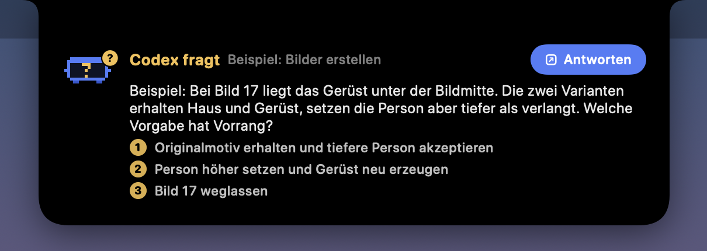

# Claude Pet: Dynamic Notch für den Mac

Die Kamera-Notch am MacBook zeigt live, was gerade wichtig ist: ob Claude Code oder Codex arbeiten, fertig sind oder etwas fragen, dazu Musik, den nächsten Termin und WhatsApp. Fährt die Maus drüber, klappt sie auf. Dazu kommt eine Karte auf dem Schreibtisch, auf der Clawd herumkrabbelt und die Claude-Limits anzeigt.

*English: a Dynamic Island-style notch for macOS. It shows Claude Code and Codex sessions (working, done, asking), lets you answer Claude's questions right in the notch, plus music, calendar and WhatsApp. Native Swift/SwiftUI, everything runs locally.*


Alle Bilder hier sind echte Renderings der App mit Beispieldaten (`ClaudePet --notch-snapshot`).

## Was die Notch kann

| | |
|---|---|
|  | **Zu:** Nur die Kamera. Arbeitet Claude oder Codex, wachsen links und rechts „Ohren“ mit dem jeweiligen Pet, Spinner, Haken oder Fragezeichen. |
|  | **Fragen:** Fragt Claude oder Codex etwas, fällt die Notch mit der Frage herunter. Claudes Fragen (`AskUserQuestion`) lassen sich per Klick direkt in der Notch beantworten. |
|  | **Fertig-Meldung:** Wird eine Session fertig, klappt die Notch kurz mit der ersten Zeile der Antwort auf. |
|  | **Termin-Alarm:** 2 Minuten vorher, mit großem „Beitreten“ bei Meet-, Zoom-, Teams- oder Webex-Links. |
|  | **WhatsApp (optional):** ungelesene Chats, Fotos, Dokumente, Sprachnachrichten zum Anhören und Antworten direkt aus der Notch. |
|  | **Musik:** Spotify oder Apple Music mit Cover, Spulen und Lautstärke. |

Aufgeklappt erscheinen nur die Rubriken, die gerade zählen. Steht eine allein, füllt sie die ganze Notch. Außerdem: Lade-Blitz beim Einstecken, eine Ablage zum Draufziehen von Dateien und ein Einstellungsfenster im Stil der Systemeinstellungen, in dem sich jede Rubrik einzeln abschalten lässt.

## Installieren

Voraussetzungen: macOS 15 oder neuer (das echte Liquid Glass gibt es ab macOS 26), die Xcode-Kommandozeilenwerkzeuge mit Swift 6.2, gebaut für MacBooks mit Notch.

```bash
git clone https://github.com/Maiki09k/claude-pet.git
cd claude-pet
./scripts/install.sh
```

Das Skript baut die App, legt sie unter `~/Applications/ClaudePet.app` ab und startet sie. Beim ersten Start fragt macOS nach Kalender-Zugriff und nach der Erlaubnis, Spotify oder Musik zu steuern. Die App ist ad hoc signiert, ohne Entwickler-Zertifikat.

Einstellungen: Claude Pet erneut öffnen (Spotlight oder Finder) oder Rechtsklick auf die Karte, dann „Einstellungen …“.

## Woher die Daten kommen

Alles läuft lokal auf deinem Mac. Es gibt keine Telemetrie und keinen eigenen Server.

- **Claude Code:** liest die Transkripte in `~/.claude/projects/*/*.jsonl` (CLI und Desktop-App), nur lesend.
- **Codex:** liest die Rollout-Dateien unter `~/.codex/sessions/` und die Namen aus `~/.codex/session_index.jsonl`, nur lesend.
- **Limits auf der Karte:** dieselbe Abfrage wie `/usage` in Claude Code. Die App liest dafür den Login der Claude-Code-CLI aus dem Schlüsselbund (`Claude Code-credentials`) und fragt `api.anthropic.com/api/oauth/usage` ab. Ist der Zugang abgelaufen, erneuert ihn die offizielle CLI. Die App speichert und schreibt keine Zugangsdaten. Der Endpunkt ist nicht öffentlich dokumentiert und kann sich ändern.
- **Termine:** der macOS-Kalender (EventKit). Google-Kalender erscheinen, wenn das Konto unter Systemeinstellungen › Internetaccounts eingebunden ist.
- **Musik:** Spotify und Musik melden Wiedergabe-Änderungen per Systembenachrichtigung, Titel und Cover kommen per AppleScript.
- **WhatsApp (optional):** liest die lokale Datenbank einer laufenden [whatsapp-mcp](https://github.com/lharries/whatsapp-mcp)-Bridge, standardmäßig unter `~/whatsapp-mcp/whatsapp-bridge/store`. Anderer Ort:

  ```bash
  defaults write io.github.maiki09k.claudepet whatsapp.store /pfad/zu/whatsapp-bridge/store
  ```

  Danach die App neu starten. Antworten gehen über die Bridge (`127.0.0.1:8080/api/send`), gesendet wird nur, was du selbst tippst und mit Enter abschickst. Profilbilder (`/api/avatar`) und „am Handy gelesen“ (Tabelle `read_marks`) brauchen eine erweiterte Bridge; ohne sie zeigt die Notch Initialen und zählt nur, was du in der Notch liest. Läuft keine Bridge, bleibt WhatsApp einfach leer.

## Claudes Fragen in der Notch beantworten

Trag den Hook in `~/.claude/settings.json` ein:

```json
{
  "hooks": {
    "PreToolUse": [
      {
        "matcher": "AskUserQuestion",
        "hooks": [
          { "type": "command", "command": "~/Applications/ClaudePet.app/Contents/MacOS/ClaudePet --ask-hook", "timeout": 130 }
        ]
      }
    ]
  }
}
```

Ruft Claude `AskUserQuestion` auf, klappt die Notch mit Frage und Antworten auf. Ein Klick gibt die Antwort an Claude zurück. Ohne Klick (Standard 30 s) oder mit „In Claude antworten“ lässt der Hook los, und Claude stellt die Frage wie gewohnt selbst. Läuft Claude Pet nicht, kehrt der Hook sofort zurück. Protokoll: `~/Library/Application Support/ClaudePet/ask.log`.

## Diagnose und Entwicklung

```bash
swift build && swift test
~/Applications/ClaudePet.app/Contents/MacOS/ClaudePet --status           # Status ohne Nachrichteninhalte
~/Applications/ClaudePet.app/Contents/MacOS/ClaudePet --notch-snapshot notch.png   # alle Notch-Zustände mit Beispieldaten
```

Die Notch liegt in einem eigenen Fenster-Space mit fester Ebene (private CoreGraphics-Aufrufe, wie bei [Boring Notch](https://github.com/TheBoredTeam/boring.notch)), damit sie beim Wechsel des Schreibtischs stehen bleibt.

## Hinweise

Ein privates Bastelprojekt, gebaut mit Claude Code. Es steht in keiner Verbindung zu Anthropic oder OpenAI. Claude, Claude Code und Clawd sind Marken von Anthropic, Codex und ChatGPT Marken von OpenAI, Spotify und WhatsApp Marken ihrer Inhaber.

Lizenz: [MIT](LICENSE).
